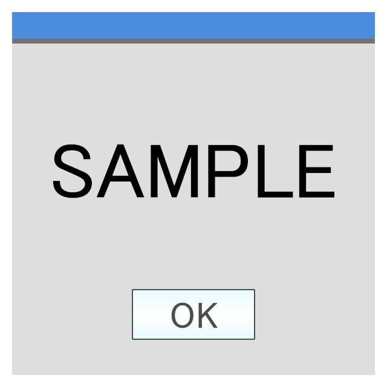

## 📝 概要

**変更内容の概要を一行で記載**
<!-- このPRで何をしたのか、簡潔に書いてください -->

### 目的

<!-- 変更目的を書いてしてください。 -->

### 背景

<!-- 変更に至った経緯や背景を書いてしてください。 -->

### 期待する動作

<!-- 変更による期待する動作を書いてしてください。 -->

## 🛠️ 変更内容

<!-- 具体的な変更箇所や修正内容を箇条書きで書いてください -->
- 
- 

## 🧪 テスト・動作確認
<!-- 動作確認した内容や、確認に使用した環境を書いてください -->
- [ ] 

### 証跡
<!-- 動作確認した際の証跡がある場合は、書いてください -->

<!-- 例： -->
- テスト実行前に、既に出力されていたログはバックアップを取り、削除しました。

<table>
    <thead>
        <tr>
            <th>No.</th>
            <th>テスト項目</th>
            <th>操作</th>
            <th>期待する動作</th>
            <th>結果(OK/NG)</th>
            <th>スクリーンショット</th>
        </tr>
    </thead>
    <tbody>
        <tr>
            <td>1</td>
            <td>機能Aの実行</td>
            <td>パラメーターに1&lt;=N&lt;100の任意の自然数を指定して機能Aを実行</td>
            <td>正常に実行されること</td>
            <td>OK</td>
            <td></td>
        </tr>
        <tr>
            <td>2</td>
            <td>機能Aの実行</td>
            <td>パラメーターに<code>1</code>を指定して機能Aを実行</td>
            <td>正常に実行されること</td>
            <td>OK</td>
            <td></td>
        </tr>
        <tr>
            <td>3</td>
            <td>機能Aの実行</td>
            <td>パラメーターに<code>99</code>を指定して機能Aを実行</td>
            <td>正常に実行されること</td>
            <td>OK</td>
            <td></td>
        </tr>
        <tr>
            <td>4</td>
            <td>機能Aの実行</td>
            <td>パラメーターに<code>0</code>を指定して機能Aを実行</td>
            <td>「不正な入力です」とエラーメッセージが表示され、機能Aが実行されないこと</td>
            <td>OK</td>
            <td></td>
        </tr>
        <tr>
            <td>5</td>
            <td>機能Aの実行</td>
            <td>パラメーターに<code>100</code>を指定して機能Aを実行</td>
            <td>「不正な入力です」とエラーメッセージが表示され、機能Aが実行されないこと</td>
            <td>OK</td>
            <td></td>
        </tr>
        <tr>
            <td>6</td>
            <td>機能Aの実行</td>
            <td>パラメーターに<code>0.99</code>を指定して機能Aを実行</td>
            <td>「不正な入力です」とエラーメッセージが表示され、機能Aが実行されないこと</td>
            <td>OK</td>
            <td></td>
        </tr>
        <tr>
            <td>7</td>
            <td>機能Aの実行</td>
            <td>パラメーターに<code>99.9</code>を指定して機能Aを実行</td>
            <td>「不正な入力です」とエラーメッセージが表示され、機能Aが実行されないこと</td>
            <td>OK</td>
            <td></td>
        </tr>
        <tr>
            <td>8</td>
            <td>機能Aの実行</td>
            <td>パラメーターに<code>-1</code>を指定して機能Aを実行</td>
            <td>「不正な入力です」とエラーメッセージが表示され、機能Aが実行されないこと</td>
            <td>OK</td>
            <td></td>
        </tr>
        <tr>
            <td>9</td>
            <td>機能Aの実行</td>
            <td>パラメーターに<code>test</code>を指定して機能Aを実行</td>
            <td>「不正な入力です」とエラーメッセージが表示され、機能Aが実行されないこと</td>
            <td>OK</td>
            <td></td>
        </tr>
        <tr>
            <td>10</td>
            <td>機能Aのログ</td>
            <td>No.1~No.9までのテストを実施</td>
            <td>
                ログに下記のみ記載されていること 
                <pre><code>Y-m-d H:i:s FunctionA - insert (1)
Y-m-d H:i:s FunctionA - insert (99)</code></pre>
            </td>
            <td>OK</td>
            <td></td>
        </tr>
    </tbody>
</table>

## 🔗 関連Issue

<!-- 関連するIssueがあればリンクを貼ってください（例: #12） -->
- Fixes #
